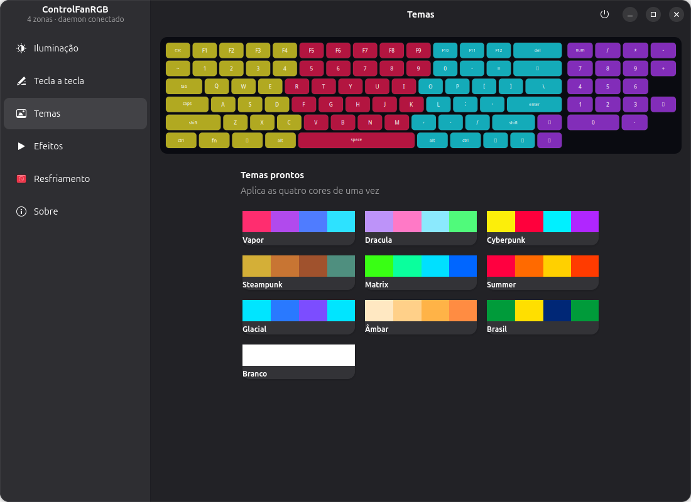
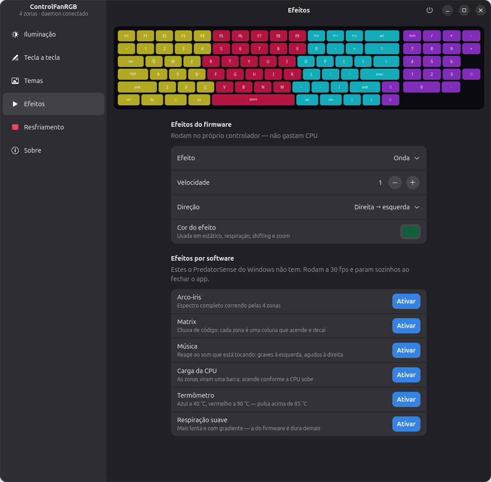
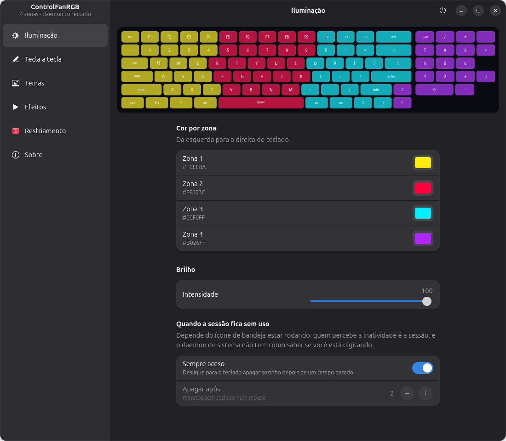
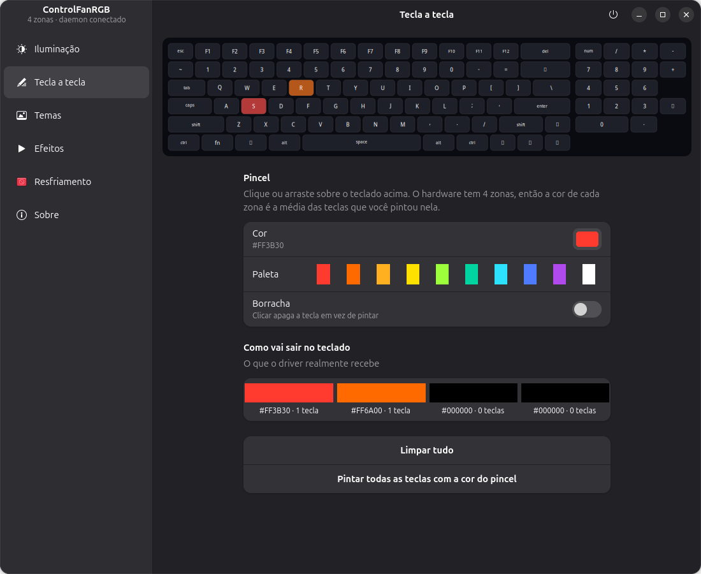
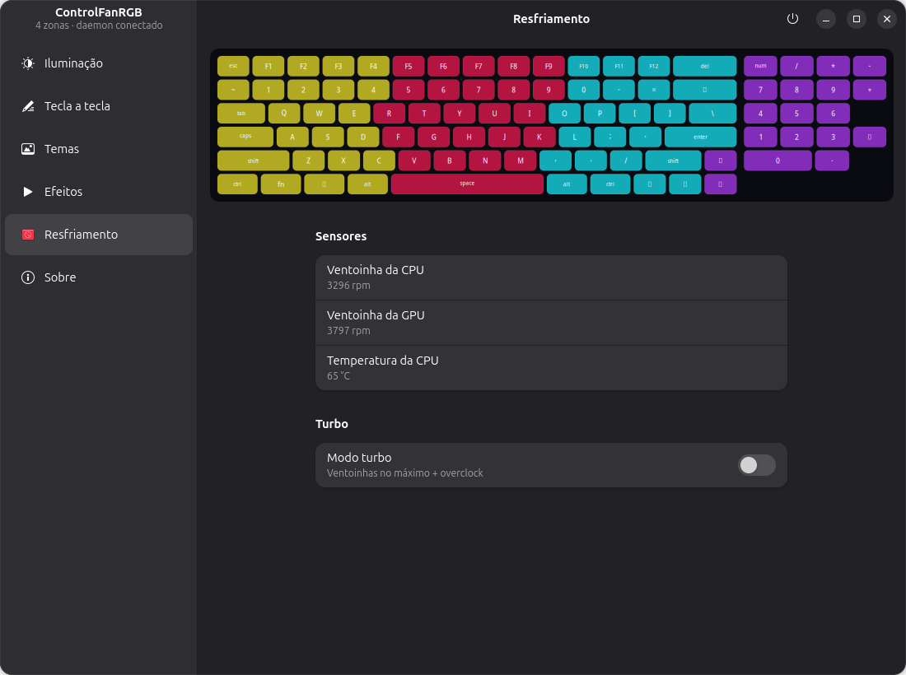
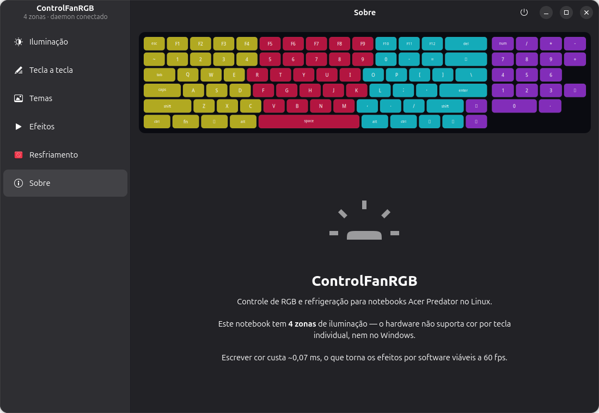

# ControlFanRGB

<p align="center">
  
</p>

Controle de teclado RGB e refrigeração para notebooks **Acer Predator** no Linux.
GTK4 + libadwaita.

> Projeto independente, sem relação com a Acer. "Predator" e "PredatorSense"
> são marcas da Acer e **não** serão usadas no nome publicado.

## Estado atual

Tudo abaixo funciona e foi testado neste hardware (Predator PH315-54):

- Cor individual das **4 zonas** + brilho
- Os 6 efeitos do firmware: estático, respiração, neon, onda, shifting, zoom
- **10 temas prontos**, incluindo Dracula e Cyberpunk com as paletas oficiais,
  mais Steampunk, Vapor, Matrix, Summer, Glacial, Âmbar, Brasil e Branco
- **6 efeitos por software** que o PredatorSense do Windows não tem:
  arco-íris, Matrix, reação à música, carga da CPU, termômetro e respiração
  suave
- Chave **Sempre aceso** ou apagar o teclado sozinho depois de N minutos
  parado
- **Desliga o apagamento automático do firmware**, que apagava o teclado
  depois de ~30 s sem tecla pressionada e ignorava as escritas de cor — era o
  motivo de o teclado "apagar sozinho" mesmo com um efeito rodando
- **Modo turbo** ligar/desligar, pela interface e pelo CLI
- **RPM das duas ventoinhas** e temperatura da CPU, ao vivo

Medido ao ligar o turbo: CPU **3061 → 5555 rpm**, GPU **3488 → 5769 rpm**.

As duas últimas exigem o patch em [`kernel/`](kernel/) — o módulo `facer`
original não expõe o turbo nem liga a leitura de ventoinha neste modelo.

- **Daemon de sistema** dono do hardware, com D-Bus, restauração no boot e no
  resume, e os efeitos continuando com a janela fechada
- **Atalhos globais**: `Super+T` turbo, `Super+K` apagar — com notificação
  mostrando o RPM real
- **Ícone no tray** com turbo, RPM ao vivo, temas e efeitos
- **Pintura tecla a tecla**, resolvida para as 4 zonas

Ainda não:

- Pacote `.deb` e PPA (o build Meson já está pronto; falta o `debian/`)
- Snap classic e Flatpak (o Flathub vai exigir ícone próprio e capturas de tela)
- Perfil automático por aplicativo

Sobre o OSD: o mockup previa um overlay flutuante, mas o Mutter **não
implementa o `wlr-layer-shell`**, então um app comum não consegue desenhar
sobre a tela no GNOME. A saída possível é a notificação do sistema (é o que
está implementado); o overlay bonito exigiria uma extensão do GNOME Shell,
que é um projeto à parte.

## As telas

<p align="center">
  
</p>

Dez temas prontos. Dracula e Cyberpunk usam as paletas oficiais; Steampunk vai
de latão, cobre e bronze ao verdete do cobre oxidado.

<p align="center">
  
</p>

Os seis efeitos do firmware rodam no controlador e não gastam CPU. Os seis por
software rodam no daemon a 30 fps e continuam com a janela fechada — inclusive
**Matrix** e **Música**, que o programa do fabricante não tem.

<p align="center">
  
</p>

Cor e brilho por zona, e a chave **Sempre aceso** — ou apagar o teclado sozinho
depois de alguns minutos parado.

<p align="center">
  
</p>

Pintura tecla a tecla. O hardware tem 4 zonas e ponto, então o app resolve a
média das teclas pintadas de cada zona e mostra o resultado na faixa abaixo do
teclado, para não haver surpresa.

<p align="center">
  
</p>

RPM das duas ventoinhas, temperatura da CPU e o modo turbo — os três exigem o
patch do módulo em [`kernel/`](kernel/).

<p align="center">
  
</p>

As imagens são geradas por [`docs/capturas/_gerar.py`](docs/capturas/_gerar.py),
que pede ao próprio GTK4 para desenhar cada página numa textura. Não é captura
de tela: o GNOME Shell 50 recusa captura por D-Bus a chamadores externos, e o
resultado assim sai sem cursor, sem sombra do compositor e sempre no mesmo
tamanho. Para refazer depois de mudar a interface:

```bash
python3 docs/capturas/_gerar.py
```

## Instalar

```bash
sudo kernel/instalar.sh          # patch do módulo: turbo + leitura de ventoinha
sudo modprobe -r facer && sudo modprobe facer
./instalar.sh                    # build com Meson, instala em /usr e ativa os serviços
./instalar-atalhos.sh            # Super+T e Super+K (sem sudo)
```

O `instalar.sh` é um atalho para o fluxo normal do Meson, que também funciona
na mão:

```bash
meson setup build --prefix=/usr
sudo meson install -C build
sudo systemctl enable --now controlfanrgbd.service
systemctl --user enable --now controlfanrgb-tray.service
```

Desinstala com `./desinstalar.sh` (que chama `ninja -C build uninstall`), e o
patch do módulo reverte com `sudo kernel/reverter.sh`. O `instalar.sh` desativa
o `acer-rgb.service` antigo, que fazia o mesmo trabalho de boot/resume. Ao
atualizar uma instalação existente, ele reinicia daemon e tray para usar o
código novo.

### Onde as coisas ficam

| Caminho | O quê |
|---|---|
| `/usr/bin/controlfanrgb` | janela e CLI |
| `/usr/libexec/controlfanrgbd` | daemon de sistema |
| `/usr/libexec/controlfanrgb-tray` | ícone de bandeja |
| `/usr/share/controlfanrgb/controlfanrgb/` | o pacote Python |
| `/usr/lib/systemd/{system,user}/` | as duas unidades |
| `/usr/share/dbus-1/system.d/` e `system-services/` | política e ativação D-Bus |
| `/usr/lib/udev/rules.d/99-controlfanrgb.rules` | turbo gravável sem root |
| `/usr/share/{applications,metainfo}/` | `.desktop` e AppStream |
| `/var/lib/controlfanrgb/state.json` | perfil aplicado no boot |

O pacote Python vai para `/usr/share` em vez de `dist-packages` porque é
privado do aplicativo: assim ele não quebra quando a distribuição troca a
versão do Python, e os três executáveis são scripts gerados que só inserem
esse diretório no `sys.path`.

**Não** existe mais instalação "de desenvolvimento" com unidades apontando
para o diretório do projeto. Uma unidade em `/etc` sombreia a de `/usr/lib`
sem avisar, então ter os dois caminhos era uma armadilha. Para desenvolver sem
instalar, use `python3 run.py` — ele continua funcionando direto do repositório.

## Rodar

```bash
python3 run.py
```

Sem o daemon instalado, a janela fala direto com o hardware (modo
desenvolvimento) — o cabeçalho mostra em qual modo está. Se o daemon estiver
instalado mas temporariamente indisponível, a janela espera sua recuperação
para não disputar os mesmos devices.

Dependências: `python3-gi`, `gir1.2-gtk-4.0`, `gir1.2-adw-1`, `python3-gi-cairo`
e o módulo de kernel `facer` carregado.

O efeito que reage à música pede mais duas, e só ele: `python3-numpy` e
`pw-record` (pacote `pipewire-bin`). Ambas são opcionais de verdade — sem elas
o resto do app funciona igual e só esse efeito fica em modo de espera.

Para turbo e leitura de ventoinha, aplique o patch do módulo:

```bash
sudo kernel/instalar.sh
sudo modprobe -r facer && sudo modprobe facer
```

Reverter: `sudo kernel/reverter.sh`.

## CLI (para atalhos de teclado)

```bash
python3 run.py --apply           # reaplica o perfil salvo
python3 run.py --off             # apaga o teclado
python3 run.py --theme Matrix    # aplica um tema
python3 run.py --turbo toggle    # alterna o turbo
python3 run.py --turbo on        # liga
```

Para ligar num atalho global do GNOME: Configurações → Teclado → Atalhos
personalizados, com o comando acima.

## Estrutura

| Arquivo | O quê |
|---|---|
| `controlfanrgb/hardware.py` | única camada que toca nos `/dev` — vira o `controlfanrgbd` depois |
| `controlfanrgb/effects.py` | motor de efeitos por software (30 fps, em thread) |
| `controlfanrgb/keyboardview.py` | preview do teclado em cairo |
| `controlfanrgb/window.py` | janela (sidebar + páginas) |
| `controlfanrgb/app.py` | Adw.Application e CLI |
| `controlfanrgb/daemon.py` | `controlfanrgbd` — serviço de sistema, dono do hardware |
| `controlfanrgb/client.py` | backend D-Bus + fallback direto |
| `controlfanrgb/tray.py` | ícone de bandeja (StatusNotifierItem + dbusmenu) |
| `controlfanrgb/perkey.py` | resolve o mapa tecla-a-tecla para as 4 zonas |
| `controlfanrgb/audio.py` | amostra o áudio da sessão para o efeito de música |
| `controlfanrgb/idle.py` | observa a inatividade da sessão (Mutter IdleMonitor) |
| `tests/` | um teste por defeito que já aconteceu — ver abaixo |
| `docs/capturas/` | as telas acima, e o script que as gera |
| `kernel/` | patch do módulo `facer` + instalar/reverter |
| `meson.build` | build e instalação em `/usr` |
| `controlfanrgb.in` | molde dos três executáveis gerados |
| `controlfanrgb/build_info.py` | versão e caminhos; o Meson gera a versão instalada |

### Arquitetura

```
GUI ─┐
CLI ─┼─ D-Bus (sistema) ─>  controlfanrgbd  ─>  facer 1.1 (DKMS)
Tray ┘                           │
                        /dev/acer-gkbbl-*
                        /sys/.../acer-wmi/turbo
                        hwmon acer (RPM)
```

O tray é um processo próprio da sessão, não parte da janela — um tray que
morre ao fechar a janela não é um tray. Ele implementa
`org.kde.StatusNotifierItem` e `com.canonical.dbusmenu` direto no barramento
de sessão, porque o `AppIndicator3` é GTK-3 e o GObject Introspection não
permite carregar Gtk 3.0 e Gtk 4.0 no mesmo processo.

O daemon é o dono exclusivo dos devices. Isso resolve a disputa entre
processos (a GUI chegou a travar a troca do módulo por *device in use*),
mantém os efeitos rodando com a janela fechada, e é o que permite empacotar
como Flatpak ou snap depois — nada confinado precisa tocar em `/dev`.

O protocolo do hardware está documentado no topo de `hardware.py` — não existe
documentação oficial dele em lugar nenhum.

### O que é de sessão, e por quê

Duas funções não podem morar no daemon, por mais que ele seja o dono do
hardware:

- **Inatividade.** No Wayland um cliente comum não vê eventos de entrada que
  não sejam para as suas janelas, então contar teclas dentro do app é
  impossível por design. Quem sabe é o `org.gnome.Mutter.IdleMonitor`, que é
  de sessão. (O `IdleHint` do logind existe, mas no GNOME não acompanha
  teclado e mouse.)
- **Áudio.** O PipeWire do usuário atende num socket em `$XDG_RUNTIME_DIR`, e
  um serviço de root lendo o áudio de quem está logado seria a arquitetura
  errada mesmo que fosse possível.

Então o **tray** faz as duas e manda ao daemon apenas o resultado: um booleano
de inatividade e cinco números de áudio. O daemon continua sendo quem desenha,
que é o que mantém os efeitos rodando com a janela fechada. O preço é que as
duas funções dependem do tray estar no ar — a janela avisa com um toast se o
efeito de música não estiver recebendo nada.

## Testes

```bash
python3 -m pytest tests/ -q
```

Não é uma suíte de cobertura: é **um teste por defeito que já aconteceu**, com
a medição que o denunciou no comentário. Nenhum precisa de hardware — teclado,
sensores e backend são dublês. O que está coberto hoje:

- o getter de propriedade do tray não pode fazer I/O (um ToolTip que chamava o
  daemon gerava 690 GetStatus por segundo)
- a primeira atualização não pode se reagendar (`idle_add` com um retorno
  `True` virava laço ocupado a 632 chamadas/s)
- os quatro estados do ciclo de áudio, inclusive o amostrador morrer sozinho
- as threads do motor de efeitos em trocas rápidas
- o efeito Música nunca renderizar preto

## Pesquisa

O levantamento completo — limitações do hardware, protocolo descoberto por
engenharia reversa, arquitetura, roadmap e o porquê da Snap Store ser hostil a
esse tipo de app — está em [`docs/PESQUISA-E-PLANO.md`](docs/PESQUISA-E-PLANO.md).

Os quatro mockups de layout estão em [`docs/mockups/`](docs/mockups/) (PNG mais
o HTML que os gerou), e a prova de conceito que originou os efeitos por
software em [`docs/poc/`](docs/poc/).

## Sobre o nome

`ControlFanRGB` é provisório. "Predator" e "PredatorSense" são marcas da Acer e
não podem ser usadas no nome publicado. Renomear o repositório depois é
barato — o GitHub mantém o redirecionamento.

## Licença

**MIT** para o aplicativo, o daemon, o tray e o CLI — ver [`LICENSE`](LICENSE).

O diretório [`kernel/`](kernel/) é **GPL-2.0-only**, por herança: o patch
deriva do `facer`, que deriva do `acer-wmi` do kernel Linux. Ver
[`kernel/LICENSE.md`](kernel/LICENSE.md). A fronteira é exatamente essa pasta
— nada fora dela é obra derivada de código GPL.
